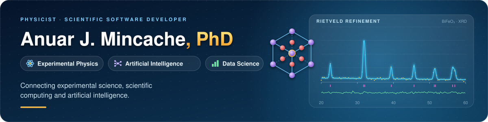

---
## 🔬 About Me

Physicist and software developer working at the intersection of **experimental science, scientific computing and artificial intelligence**.

I develop computational solutions for scientific data analysis, machine learning, experimental instrumentation and AI-assisted research, with a focus on transforming scientific problems into reproducible computational tools.

---

## 🌍 NAPI GeoAI · Inteligência geoespacial

 

 

**NAPI GeoAI** é uma plataforma científica **em desenvolvimento** para conectar dados territoriais oficiais, geoprocessamento, análise de aptidão energética e mapas interativos. O primeiro estudo planejado é a aptidão territorial preliminar para energia fotovoltaica no Paraná.

**Idealização e liderança técnica:** Anuar Mincache, membro do NAPI Energia Zero Carbono. Participam como colaboradores científicos Luiz Fernando Cotica, Ivair Aparecido Santos e Gustavo Sanguino Dias.

**[Repositório e documentação](https://github.com/anuarmincache/napi-geoai)** · **[Roadmap](https://github.com/anuarmincache/napi-geoai/blob/main/ROADMAP.md)**

Arte conceitual: a representação territorial é ilustrativa e não constitui um resultado geoespacial medido ou validado.

---

## 🎯 Current Focus

**Scientific AI • Experimental Instrumentation • Materials Science • LLMs & RAG • Scientific Software**

## 🧪 Research & Development

- ⚛️ Experimental Physics and Scientific Instrumentation
- 🤖 Artificial Intelligence applied to scientific problems
- 🧠 Machine Learning and Data Science
- 🐍 Scientific Computing with Python
- 💬 Large Language Models (LLMs) and RAG
- 🔬 Materials characterization and scientific data analysis
- 💻 Scientific software development

## 🚀 Selected Projects

### 🔬 Rie-agent
AI-assisted Rietveld refinement using GSAS-II, automated workflows and physics-based validation for crystallographic analysis.

### 🛡️ Blindagem-ML
Machine-learning-assisted software for ionizing radiation shielding analysis, combining predictive models with analytical physical calculations.

### 🧬 Consciência Materiais
Computational platform focused on materials science and intelligent analysis of scientific information.

### ⚙️ Modern Data Stack
Data engineering project integrating modern pipelines, analytics, machine learning and visualization technologies.

### 📈 Observatório Dengue
Data science application for analysis and visualization of epidemiological information.

### 📝 AI for Scientific Writing & Physics
Resources connecting artificial intelligence, scientific writing, data analysis and physics research.

### 🧮 Computational Physics
Numerical methods and Python applications for solving physics problems.

## 🛠️ Technologies

  

---

### ⚛️ Physics + 📊 Data + 🤖 Artificial Intelligence

**Scientific and Technological Solutions**

